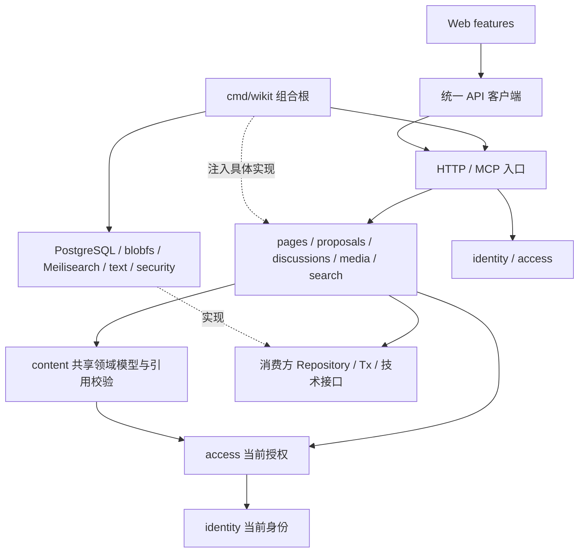
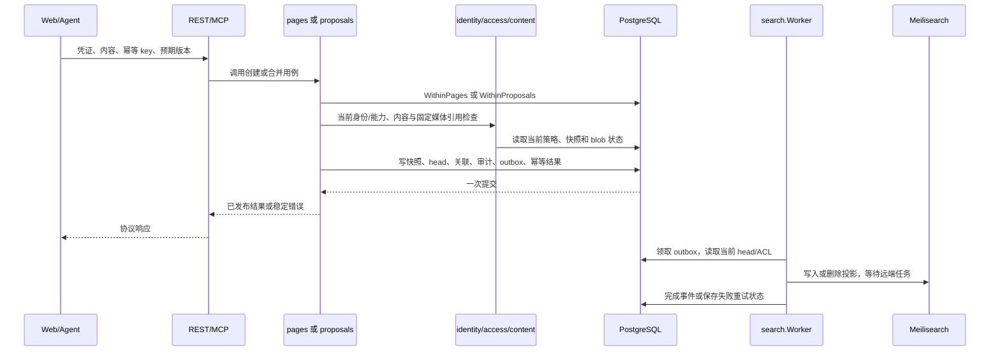

# 模块划分与协作

本文说明现有模块由谁负责、通过什么接口协作，以及一次操作如何从入口走到持久化和异步投影。
产品范围见[需求](../requirements.md)，权限和状态判定见[业务规则](../business-rules.md)，表约束见[数据设计](data-model.md)。

## 模块职责与代码归属

| 模块 | 代码位置 | 拥有的职责与输出 | 协作边界 |
| --- | --- | --- | --- |
| 组合根 | [cmd/wikit](../../cmd/wikit/main.go) | 配置、构造依赖、注册入口、启动与停止 worker、管理命令 | 唯一集中装配具体实现的位置，不承载领域判定 |
| 身份 identity | [core/identity](../../internal/core/identity/types.go) | 账户认证、会话、Token、密码与当前 Actor | 向其他 Core 模块提供 Credentials、Authentication、Require；密码和随机数由接口注入 |
| 授权 access | [core/access](../../internal/core/access/access.go) | 当前页面能力、角色、组、ACL 和账户/组治理 | 复用 identity；提供 Authorization、Authorize、CheckPolicy，供用例在自己的事务内调用 |
| 内容 content | [core/content](../../internal/core/content/snapshot.go) | Page/Published/Snapshot 类型、内容规范化、标签筛选和固定媒体引用校验 | 共享领域模型与函数，不是独立服务；通过 ReferenceReader 和 Originals 检查引用 |
| 页面 pages | [core/pages](../../internal/core/pages/pages.go) | 创建与首次发布、页面/历史/目录/标签读取、页面治理 | 使用 identity/access/content；读取候选时使用 proposals 的公开类型，不发起提案状态变更 |
| 提案 proposals | [core/proposals](../../internal/core/proposals/service.go) | 候选快照、diff、rebase、合并、关闭/重开、恢复/撤销提案 | 使用 content 规范化与引用检查、access 授权、Lines 差异接口；自己拥有发布事务，不调用 pages.Service 嵌套提交 |
| 讨论 discussions | [core/discussions](../../internal/core/discussions/service.go) | 页面议题、评论、状态、同页提案关联与讨论治理 | 通过自己的 Tx 查询页面和提案关联，调用 access；关联不触发合并或自动关闭 |
| 媒体 media | [core/media](../../internal/core/media/model.go) | 上传预约/租约、原件读取、提交和 GC | BlobStore 管理文件，Tx 管理元数据与引用；供页面/提案使用的 ready blob 通过持久化状态交接 |
| 检索 search | [core/search](../../internal/core/search/model.go) | 授权全文读取、RAG 规划/融合/覆盖、索引投影和恢复 | Index 只提供候选/索引操作，Repository 提供当前权威数据；Worker 通过持久 outbox 衔接写入 |
| 健康 health | [core/health](../../internal/core/health/health.go) | readiness 协调 | 消费 Check 接口探测数据库和媒体目录，不替代业务授权或完整搜索验收 |
| 错误 fault | [core/fault](../../internal/core/fault/fault.go) | 稳定领域错误类别与安全响应语义 | 用例返回错误，由入口映射到协议；不把底层诊断直接返回客户端 |
| REST / MCP | [adapters/http](../../internal/adapters/http)、[adapters/mcp](../../internal/adapters/mcp) | 解析凭证、请求与预期版本，调用用例，映射结果/错误 | 共用同一组 Service；不直接查询数据库或独立实现权限 |
| Web 交付 | [adapters/webui](../../internal/adapters/webui) | 提供内嵌静态资源及 SPA 入口 | 与 /api、/mcp、/health 路由隔离；不是业务模块 |
| PostgreSQL | [storage/postgres](../../internal/storage/postgres) | 实现各用例的 Repository/Tx、事务锁、SQL、迁移、outbox | 依赖 Core 定义的接口与类型；内部共享事务实现不向协议层暴露 |
| 文件与搜索适配器 | [storage/blobfs](../../internal/storage/blobfs)、[search/meili](../../internal/search/meili) | 原件文件操作、Meilisearch 协议与远端任务 | 实现 Core 消费方接口，不判定页面权限或发布状态 |
| 文本与凭证适配器 | [text](../../internal/text)、[security](../../internal/security) | Unicode/Markdown/diff、哈希与随机秘密 | 提供技术原语；业务如何使用这些结果由 Core 决定 |
| Web 应用 | [web/src/features](../../web/src/features)、[API 客户端](../../web/src/lib/api.ts) | 页面交互、内存草稿、身份状态、请求与结果展示 | features 通过统一客户端访问 REST；基础 UI 不依赖业务用例，不自行计算有效权限 |

## 依赖和装配如何连接

下面的箭头表示代码依赖或注入，不代表每个模块都会逐级调用所有模块。

组合根先打开 PostgreSQL，装配文件、文本、凭证和搜索适配器，再构造各 Core Service。
HTTP API 与 MCP Services 收到同一批 Service 实例，因而复用用例而不是通过 HTTP 相互转调。
`serve` 同进程启动 search.Worker；搜索管理命令复用这个 Worker，GC 命令调用 media.Service。
当前没有独立 `internal/worker` 模块或消息队列，不能把架构图中的 Worker 当成已部署的独立服务。

业务模块之间主要有三种协作方式：

1. **同步领域调用**：例如 proposals 调用 access 授权、content.Normalize 和 content.CheckReferences；
   使用公开函数与类型，继续处于发起用例的事务边界。
2. **同一事务的持久化协作**：例如合并同时更新发布快照、页面 head、提案状态、审计和 outbox；
   由 proposals.Tx 暴露所需操作，PostgreSQL 实现一次提交，不串联多个 Service 各自提交。
3. **提交后的异步协作**：页面或权限变化留下 outbox，search.Worker 随后读取当前状态更新投影；
   不靠内存通知保证交付，也不把远端索引调用放进发布事务。

pages 对 proposals 的依赖限于候选读取的公开模型；proposals 通过 content 的页面与发布模型处理修改，
不反向依赖 pages。共享 content 避免两个业务 Service 为读写相同内容互相调用而形成循环。

## 接口与事务交接

| 消费方接口 | 实现者 | 交接内容与边界 |
| --- | --- | --- |
| identity.Repository / access.Repository | postgres.Store | WithinIdentity / WithinAccess 回调，当前身份、账户/组/策略与审计 |
| pages.Repository / proposals.Repository | postgres.Store | WithinPages / WithinProposals 回调，内容、预期版本、关联、发布与幂等 |
| discussions.Repository / media.Repository | postgres.Store | WithinDiscussions / WithinMedia 回调，讨论治理或上传/原件状态 |
| search.Repository | postgres.Store | WithinSearch 回调，当前索引、候选对应快照/权限、修复事件和游标 |
| search.WorkerRepository / Queue | postgres.Store | WithSearchWorker、事件领取、远端任务编号、失败重试、索引切换 |
| content.Text / proposals.Lines / search.Text | text.Parser / text.Differ | 规范化、源块解析、纯文本与逐行差异，不包含授权 |
| content.Originals / media.BlobStore | blobfs.Store | 原件完整性检查及流式文件操作，不授予 Page 访问权 |
| search.Index | meili.Client | 候选 ID/版本和远端任务结果，不作为最终正文或权限来源 |
| identity.Passwords / identity.Secrets | security 实现 | 哈希验证、随机值和摘要；凭证生命周期仍由 identity 控制 |

`Within…` 回调由 PostgreSQL 适配器绑定统一授权事务；Core 在回调中完成需要原子性的读取、判定和写入。
事务失败则整组业务变化回滚，传输层不能拿到裸 SQL transaction。限流等需要独立提交的操作保持独立，
不能因为业务失败而抹掉失败尝试计数。网络检索、长时间流式上传不持有该授权事务。

## 创建与合并如何串联

创建新页面由 pages 主导，已有页面修改由 proposals 主导，两者在发布后通过同一 outbox 路径进入检索。

创建检查 create_page 并分配 Page 与首个发布快照，不创建提案。合并检查 open 状态、当前 merge 能力、
候选/base/head 和媒体可用性，锁定页面与提案后写入直接子版本并标记 merged。
索引暂时失败不会撤销已经提交的发布；失败事件留待重试。相反，数据库事务失败不能返回发布成功。
相同幂等 key 的重放仍检查当前可读性，不能借先前成功结果绕过撤权。

## 搜索与 RAG 如何串联

1. Web 通过 REST 发起关键词搜索；MCP 将 lexical 或 rag 请求交给同一 search.Service。
2. search 取得当前身份、组和索引信息，构造候选过滤条件；网络检索在授权事务外调用 Index。
3. lexical 使用关键词候选；rag 先规划主体/属性/阶段与约束，再在预算内多路召回、融合和选择候选。
4. search 通过 Tx 批量读取 PostgreSQL 的当前内容、head、标签与 ACL，跳过失效候选并安排修复。
5. 最终授权事务再次复核当前状态，从当前快照经 Text 提取段落；rag 只对返回证据逐项计算覆盖。
6. 入口序列化结果，Web 展示摘录与固定版本链接；MCP 调用方依据覆盖情况生成答案。

这里没有 `search → pages.Service → REST` 的绕行：search 通过自身 Repository 和共享 access/content
访问用例所需的数据。Meilisearch 不能自行授予权限，MCP 也不能在序列化时把不足的证据改为完整答案。
远端查询失败返回稳定的检索错误；跨批撤权或 head 变化导致候选丢弃，而不是继续返回缓存正文。

## 媒体如何与内容发布衔接

上传入口先调用 media 预约，再向同源 PUT 路径发送文件；MCP 工具只返回预约信息，不接收二进制参数。
media 在短事务中领取上传 attempt，随后通过 BlobStore 流式写 staging，不占用授权事务。
完成时重新鉴权、核对租约和大小/MIME，提交不可变原件并登记 ready blob，最后返回 blob ID。

创建媒体 Page 或修改媒体提案时，pages/proposals 从 Tx 查询该 blob，检查使用权与 ready 状态；
文档引用媒体时，content.CheckReferences 在发起方事务内检查目标 Page 当前权限、固定 Revision 和原件。
模块之间传递的是 blob ID、固定发布引用与共享领域类型，不是服务器路径，也不是一次上传即永久有效的授权。

读取原件由 media 根据源 Page/候选/发布版本重新鉴权后打开文件。
GC 与发布共享授权事务顺序：先标记删除意图，事务外删除文件，再登记完成；
上传租约和任何候选/发布历史引用都保护原件。文件提交成功但数据库登记失败留下孤立文件，由 GC 延后回收。

## 治理、讨论与身份如何影响其他模块

账户禁用、Token 撤销、组成员或页面 ACL 变化经 identity/access 的事务提交。
pages、proposals、discussions、media 和 search 下一次授权读取当前状态，不等待客户端刷新或搜索投影追上。
涉及搜索可见性的变化写入持久事件，再由 Worker 更新投影；异步投影落后不放宽最终读取权限。

discussions 创建评论、改议题状态或关联提案时调用共享授权，并经自己的 Tx 验证同 Page 归属。
它不调用 proposals.Merge，也不因提案合并自动关闭议题。隐藏讨论和页面通过显式治理入口处理，
普通列表与治理列表使用各自授权条件，不由 Web 隐藏行来实现数据隔离。

## Web 端的协作路径

`account` 负责会话状态，`reading` 负责阅读/搜索/历史，`editing` 负责编辑与离开保护，
`proposals`、`discussions`、`governance` 分别承担对应交互；公共布局和基础 UI 只负责展示。
这些 feature 通过 `web/src/lib/api.ts` 统一处理 Cookie/CSRF、请求取消、幂等 key 和错误，
接口类型来自生成契约，页面操作按 Core 返回的 capabilities 展示。
身份变化清理草稿与内容子树、取消在途读取；服务端仍对每次请求独立鉴权。

## 修改时如何定位影响

新增或变更用例时，先确定唯一主导模块，再列出它读取的身份/内容、需要的消费方接口、
同一事务写入项和提交后的事件。沿上述调用链同步业务规则、数据约束、两个传输入口、Web 消费者和验收。
依赖边界测试防止 Core 引入适配器，真实集成测试验证事务与竞态，REST/MCP 等价测试验证入口没有复制业务。
不得只添加目录或接口而宣称模块已经实现，也不得把设计图中的调用当作运行证据。
