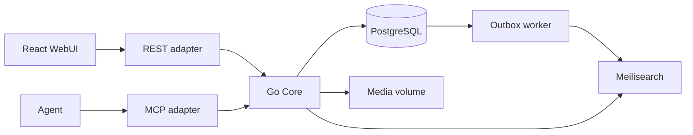

# 系统架构

产品范围见[需求](../requirements.md)，领域行为见[业务规则](../business-rules.md)。本文只定义组件职责与依赖。

## 组件与依赖

Core 拥有账户权限、发布、提案、讨论、媒体及搜索用例。传输适配器只处理
协议编解码、认证凭证提取和响应映射。Core 每次用当前账户状态鉴权；
任何搜索结果、媒体引用、旧版本和 MCP 工具都不能绕过它。

业务模块相互通过公开用例接口协作；外部服务通过模块所需的小接口接入。
依赖方向与可执行评审要求见[代码规范](../engineering/coding-standards.md)。
同一进程运行可恢复 outbox worker，不引入独立消息队列。

搜索按需批量复核，页面目录按数值 ID 锚点分页；最终响应重验当前权限，网络读取不持业务锁。
性能优化以测量为依据，不能削弱事务一致性。

## 技术与数据流

Go 模块化单体承载 Core；PostgreSQL 是业务状态与不可变历史的权威来源，
本地卷保存不可变媒体，Meilisearch 是可重建搜索投影。Web 使用 React、TypeScript、Vite 和 shadcn/ui。
依赖的精确版本由清单与锁文件维护，不在设计文档重复列清单。

写入在 Core 的授权事务中提交领域数据、审计及 outbox；worker 按页面顺序更新搜索投影。
读取经 Core 重新验证当前权限与发布快照；搜索服务返回候选，不能直接向客户端提供正文。
REST 和 MCP 调用同一组用例，Web 只消费接口返回的能力和结果。

## 配套设计

- [模块划分与协作](modules.md)：模块所有权、消费方接口、事务与异步调用链。
- [数据设计](data-model.md)：实体、约束、迁移与持久化边界。
- [架构决策](decisions.md)：当前选择、理由和代价。
- [REST](../interfaces/rest.md)、[MCP](../interfaces/mcp.md)、[WebUI](../interfaces/web.md)：各入口的契约。
- [运维](../engineering/operations.md)：进程、部署、备份和恢复。
