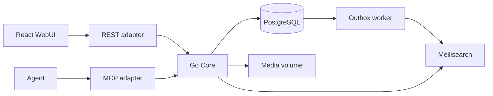

# 产品与架构

## 定位与边界

Wikit 是单站点、面向公开社区的自托管 Wiki，源码 MIT。站点内容许可独立配置。
以标签组织知识，文档和媒体均为独立 Page。允许公开和受限页面。
首版不实现原生 Git、S3、多租户、模板、通知、实时协作、语义检索或高可用。

技术基线：Go 模块化单体、PostgreSQL、Meilisearch、本地不可变媒体；
React + TypeScript + Vite + shadcn/ui。确切依赖版本在对应实现 Issue 中选择、
记录并锁定，不在代码中追踪浮动 latest。

## 组件与依赖

Core 拥有账户权限、发布、提案、讨论、媒体及搜索用例。传输适配器只处理
协议编解码、认证凭证提取和响应映射。Core 每次用当前账户状态鉴权；
任何搜索结果、媒体引用、旧版本和 MCP resource 都不能绕过它。

业务模块相互通过公开用例接口协作；外部服务通过模块所需的小接口接入。
依赖方向与可执行评审要求见[代码规范](coding-standards.md)。
同一进程运行可恢复 outbox worker，不引入独立消息队列。

## 内容结构

Issue #4 实现页面创建、当前/历史读取、首提案及候选历史读取、目录和标签过滤。
Issue #5 实现审核与原子发布，Issue #6 实现上传、固定版本下载和安全 GC；搜索投影仍属 #8。
Issue #7 实现 Page Issue、不可变评论、同 Page 提案关联与显式治理视图；权限与状态规则见协作文档和 ADR 0012。
Issue #8 实现中英文搜索、事务 outbox 和索引恢复；最终响应由 Core 复核当前 ACL 与发布版本，见 ADR 0013。
Issue #9 实现官方 SDK 的 Streamable HTTP MCP，41 个工具直接复用 Core；session 与当前凭证绑定，见 ADR 0014。
约束测试可使用数据库 fixture，正常发布用例必须走审核合并。创建不产生发布版本或搜索事件。

标题去首尾空白并做 NFC，保留大小写；标签输出为 NFC + Unicode case fold 后的 key，
去重并按 key 排序（不保留同 key 的显示变体）。Core 负责这些规则，Unicode 和
CommonMark AST 解析通过消费方小接口注入。代码块里的 URL 不登记为媒体引用。
内部媒体引用必须使用相对、固定发布版本 content 路径；拒绝点段、重复斜杠、反斜杠等可规范化为内部路径的变体，以及未固定 revision 的引用、
危险协议及 query/fragment 变体。原始 HTML 不作为可执行内容处理。

- Page 的 UUID 是稳定标识。标题可重复、可修改，不作为路由或权限标识。
- `document` 内容为 Markdown；`media` 内容为 blob 引用和 Markdown 描述。
  类型创建后不可变。所有快照同时包含标题与排序规范化后的标签集合。
- 标签去除首尾空白、Unicode NFC 规范化、按不区分大小写的 key 去重；
  不支持嵌套、分类或全站手工改名。改标签通过页面提案。
- 内部页面链接使用 `/pages/{page_id}`；媒体引用使用固定发布版本的
  `/api/v1/pages/{page_id}/revisions/{revision_id}/content`。
  引用不会授予访问权限，读者无权访问时显示不可用占位。
- 新建 Page 原子创建无 head 的 Page 与创建提案。创建者获得该未发布页面
  的 read/propose/discuss 权限，不自动获得 review/manage。
  初始 visibility 可由创建者选择；新建后的 ACL 仍由管理者控制。
- 未发布页面不进入公开目录和搜索，但公开创建提案可以通过提案队列查看；
  受限新页面由作者授权范围及站点管理员处理首次发布。
- 页面首页只展示已发布版本；候选内容只在提案视图出现。

## WebUI 主要视图

Issue #10 的路由、状态、错误和验证约定见 [WebUI](web.md)，状态边界见 ADR 0015。

公开首页、标签过滤、搜索；页面阅读、历史与版本 diff；Markdown 编辑及预览；
媒体 Page 与原件下载；提案列表、对比、评审、冲突解决与合并；
页面 Issue 与评论；注册登录、个人 Token；页面权限和管理员用户／组管理。
受限或隐藏对象不可通过 UI 响应暴露标题等元数据。

Markdown 渲染不执行原始 HTML，链接与媒体 URL 进行协议白名单检查；
客户端限制只改善体验，Core 必须独立校验。

## 非功能目标

单机 Compose 为支持基线。目标测试集约 10 万 Page、100 并发请求。
延迟、吞吐和恢复时间先测量再形成承诺。所有不可逆操作记录账户和请求关联 ID；
日志不得包含密码、Token、会话值或受限页面正文。
