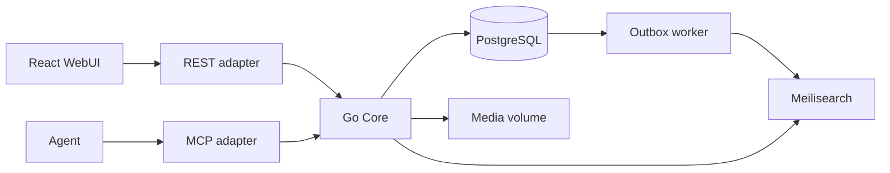

# 产品与架构

当前发布规则见 [ADR 0018](adr/0018-wiki-publication-redesign.md)（Issue #35）。

## 定位与边界

Wikit 是单站点、面向公开社区的自托管 Wiki，源码 MIT。站点内容许可独立配置。
以标签组织知识，文档和媒体均为独立 Page。允许公开和受限页面。
首版不实现原生 Git、S3、多租户、模板、通知、实时协作、语义检索或高可用。

技术基线：Go 模块化单体、PostgreSQL、Meilisearch、本地不可变媒体；
React + TypeScript + Vite + shadcn/ui。确切依赖版本在对应实现 Issue 中选择、
记录并锁定，不在代码中追踪浮动 latest。

## 组件与依赖

Core 拥有账户权限、发布、提案、讨论、媒体及搜索用例。传输适配器只处理
协议编解码、认证凭证提取和响应映射。Core 每次用当前账户状态鉴权；
任何搜索结果、媒体引用、旧版本和 MCP resource 都不能绕过它。

业务模块相互通过公开用例接口协作；外部服务通过模块所需的小接口接入。
依赖方向与可执行评审要求见[代码规范](coding-standards.md)。
同一进程运行可恢复 outbox worker，不引入独立消息队列。

## 内容结构

页面创建直接发布首版，修改通过独立提案检查差异后合并；没有单独审核阶段。
首页为固定 Page 1，部署初始化公开文档，普通用户可提案且只有管理员可合并。
REST 与 39 个 MCP 工具复用 Core。讨论、媒体、搜索、账户和治理沿用各自模块边界。

标题去首尾空白并做 NFC，保留大小写；标签输出为 NFC + Unicode case fold 后的 key，
去重并按 key 排序（不保留同 key 的显示变体）。Core 负责这些规则，Unicode 和
CommonMark AST 解析通过消费方小接口注入。代码块里的 URL 不登记为媒体引用。
内部媒体引用必须使用相对、固定发布版本 content 路径；拒绝点段、重复斜杠、反斜杠等可规范化为内部路径的变体，以及未固定 revision 的引用、
危险协议及 query/fragment 变体。原始 HTML 不作为可执行内容处理。

- Page 的递增正整数 ID 是稳定标识。标题可重复、可修改，不作为路由或权限标识。
- `document` 内容为 Markdown；`media` 内容为 blob 引用和 Markdown 描述。
  类型创建后不可变。所有快照同时包含标题与排序规范化后的标签集合。
- 标签去除首尾空白、Unicode NFC 规范化、按不区分大小写的 key 去重；
  不支持嵌套、分类或全站手工改名。改标签通过页面提案。
- 内部页面链接使用 `/pages/{page_id}`；媒体引用使用固定发布版本的
  `/api/v1/pages/{page_id}/revisions/{revision_id}/content`。
  引用不会授予访问权限，读者无权访问时显示不可用占位。
- 创建需要管理员授予的 create_page（个人或组）。原子创建 Page 与首个 Revision、head、
  关联、审计和搜索事件；作者保留 read/propose/discuss，不自动获得 merge/manage。
- 版主 moderator 可合并普通公开页，受限页仍需明确 merge 授权；允许有权作者自合并。
- `/` 是普通公开文档 Page 1，没有首页选择器；不可删除、隐藏、替换或改为受限。
- 阅读只展示已发布版本，候选仅在提案视图出现。受限/隐藏对象按当前权限隔离。

## WebUI 主要视图

Issue #10 的路由、状态、错误和验证约定见 [WebUI](web.md)，状态边界见 ADR 0015。

普通文档首页、搜索、标签与类型过滤；页面阅读、历史与版本 diff；Markdown 编辑及预览；
媒体 Page 与原件下载；提案列表、对比、冲突解决与合并；
页面 Issue 与评论；注册登录、个人 Token；页面权限和管理员用户／组管理。
受限或隐藏对象不可通过 UI 响应暴露标题等元数据。
前台不设站点侧边栏、全部页面或全站提案页面；页面标题居左、页面工具居右，在正文顶部共用一行，窄屏换行（ADR 0019，Issue #45）。提案入口属于具体 Page。
创建页面仅在搜索无结果时提供入口（Issue #41）；Page 之间没有所属层级，所有页面均不显示面包屑（Issue #43）。具体展示条件见 WebUI。

Markdown 渲染不执行原始 HTML，链接与媒体 URL 进行协议白名单检查；
客户端限制只改善体验，Core 必须独立校验。

## 非功能目标

单机 Compose 为支持基线。目标测试集约 10 万 Page、100 并发请求。
延迟、吞吐和恢复时间先测量再形成承诺。所有不可逆操作记录账户和请求关联 ID；
日志不得包含密码、Token、会话值或受限页面正文。
